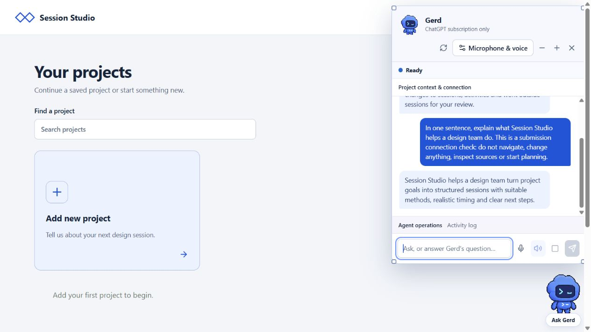

# Verified submission — 29 October 2026

Source baseline: integration commit `65d7bfa15a9ac97c764eb5bda4a1f6fa1b609b44`. Packaged application/setup code: `5e5ca4c73daa019a9cbffd99dea861e0838e9de1`. The final publication adds this evidence report and screenshot; it does not change the tested runtime code.

## Clean-install CI: both operating systems passed

[Successful Windows and macOS workflow](https://github.com/ma-lai-ka/session-studio-group-4-source-code/actions/runs/40784181814).

Both `windows-latest` and `macos-latest`, using Node 22 and Python 3.12, passed:

- Fresh locked dependency installation and isolated Python setup.
- All database migrations and rendering a real Delft PDF page.
- Repeat setup with a persisted database sentinel retained.
- Offline doctor checks against the actual database and rendered source.
- TypeScript checking, 166 application tests and six setup/handoff tests (172 total).
- Production compilation and workspace API smoke checks: sign-in/origin boundaries, project/session sync, stable block references, uploads, comments, templates and imported copies.

Application tests cover preliminary sessions, goal scope, automatic planning continuation, brief/proposal validation, source review, approval/rejection, stale and completed work, undo, runner completion, export/import, Stop/mute-related coordination and voice event handling. The optional fictional example imports and round-trips through the same project validation.

## Additional local verification

Windows local clean setup used Node 24.22.1 and Python 3.12.14, without copying any existing node_modules, database or companion history. Source files were copied only from the recorded Git commit. The setup driver reused the author's installed Node/Python executables explicitly; the application then used its newly prepared isolated Python environment. CI separately verifies ordinary PATH-discovered prerequisites on clean machines.

- Fresh setup, repeated setup and retained database data passed.
- The official npm package `@openai/codex@0.165.0-alpha.1.2` was freshly installed privately for the checkout, without replacing a global installation.
- Doctor verified that package's actual ChatGPT subscription authentication, remaining included allowance and native v3 voice catalogue. No API key was used. No account information or authentication state is included in the submission.
- The documented root launcher opened the packaged website at an explicit test port (5193). Same-checkout reuse was verified; occupied unrelated listeners were not killed.
- A fresh browser showed no author projects. Exactly one live text request returned a valid Gerd response. Gerd's chat was hidden while the request ran, and the response was available when reopened. No planning changes or other live AI turns were requested during this packaging check.

## Physical audio is a separate check

The user previously confirmed microphone/speaker conversation on the integration source installation. This packaging pass checked account/voice capabilities and automated voice behavior, but did not capture a microphone or verify audible replies. It does not establish physical audio operation on the professor's computer. Follow the walkthrough for that human test. Native voice remains an experimental external capability.

No deployment occurred. The original repository's main and integration branch were not changed by this submission work. No credentials, private context, conversations, browser projects or author databases were committed.
